# ROCC Wallpaper Studio

**把 ROCC 的设计经验，变成你自己的动漫壁纸创作工作流。**

ROCC Wallpaper Studio 是一个免费的动漫壁纸创作项目，包含简易网页工作台，以及可用于 **Codex / Claude Code** 的 Agent Skill。选择创作方向、描述主题，再用你自己的图像工具或 API 生成并检查作品。

**Anime wallpaper workflows for your own AI tools.** A bilingual web studio and a portable Codex / Claude Code Skill, with four art directions and structured visual review.

[网站入口 · 中文](https://rocc-wallpaper-studio-lab.rocc94.chatgpt.site/?lang=zh#studio) · [Website · English](https://rocc-wallpaper-studio-lab.rocc94.chatgpt.site/?lang=en#studio) · [用 Codex / Claude Code 创作](https://rocc-wallpaper-studio-lab.rocc94.chatgpt.site/?lang=zh#install)

> **访问状态 / Access:** 网站现已公开，任何人均可访问，无需 ROCC 账号。GitHub 仓库与 Skill 同样公开。The website, repository and Skill are public. No ROCC account is required.

## 不填 API Key，直接用本机工具

1. 打开 [无需 Key 的创作入口](https://rocc-wallpaper-studio-lab.rocc94.chatgpt.site/?lang=zh#install)，选择 Codex 或 Claude Code，填写主题、风格和比例。
2. 点击打开本机工具。网页带上完整任务及读取 GitHub Skill 的说明；在工具里核对后发送。
3. 使用会话内置或已经配置的图像工具生成并检查作品。没有图像工具时，交付制作单和提示词，不要求临时新增 Key。

已有 Skill 的用户也可直接在 Codex / Claude Code 中说：`使用 ROCC Wallpaper Studio Skill，为我制作一张……`。模型、图像能力和用量取决于你自己的账号和配置；本站不提供模型额度。Claude Code 本地链接需其协议处理器已注册；Claude 桌面端或复制指令可作替代。GitHub Markdown 可能不允许自定义应用协议，因此请通过上方 HTTPS 网站入口打开。

**No-key workflow:** [Open the local-agent launcher](https://rocc-wallpaper-studio-lab.rocc94.chatgpt.site/?lang=en#install), choose your tool, then review and send the prefilled task locally. It carries the Skill source and design settings. Use existing image tools; if none are available, receive an unexecuted brief. No API key is required by ROCC for this workflow.

## Skill 作品精选

**从构图到完成度，用作品展示 ROCC Skill 的设计表达。**

本次新增20件作者提供、并确认由当前Skill创作的作品，涵盖Q版群像、单人收藏海报、合力动作、叙事光影、平面构成、足球主题联动与分镜拼贴。每件作品都配有中英文设计说明与实际尺寸。作品数量不作为独立评测或成功率。

[浏览完整 20 件作品与设计说明](SHOWCASE.md) · [在网站查看作品集](https://rocc-wallpaper-studio-lab.rocc94.chatgpt.site/?lang=zh#showcase)

| Q版群像 / Chibi ensemble | 叙事光影 / Narrative light |
| --- | --- |
| 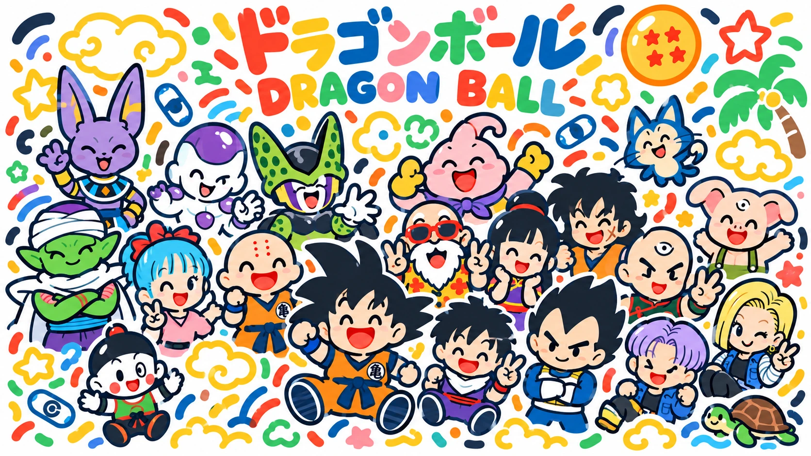<br>**彩色派对 · Q版全员合影**<br>多人造型统一 · 高饱和配色 · 群像疏密 | 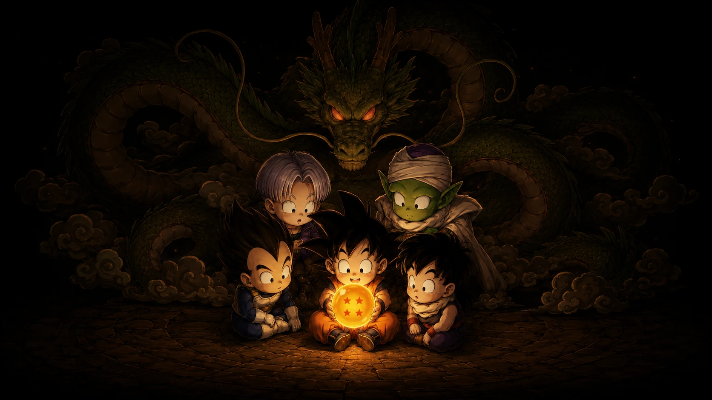<br>**龙珠微光 · 夜色围坐**<br>单一叙事光源 · 暗部层次 · 前后景呼应 |
| 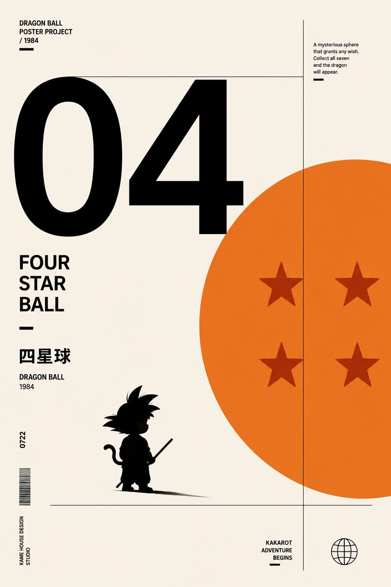<br>**四星球 04 · 编辑网格**<br>编辑网格 · 字体尺度 · 插画与排版整合 | 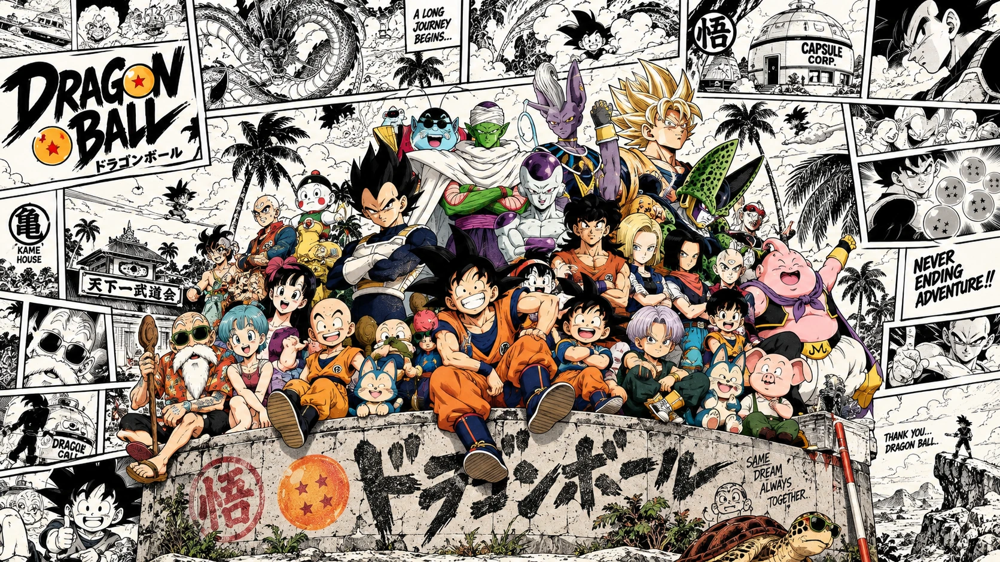<br>**永不结束的冒险 · 群像长卷**<br>共同空间落点 · 群像中心展开 · 故事层次 |

<details>
<summary><strong>展开全部20件作品及说明 / All 20 works and design notes</strong></summary>

## 01 · 彩色派对 · Q版全员合影

**Color party · chibi ensemble** · Dragon Ball


用统一的圆润轮廓和高饱和点色，容纳大量角色。中央主角与四周人物保持清晰间距，彩带和云纹补足节庆节奏。

Rounded contours and bright color accents unify a large cast. Clear spacing protects every face while confetti and cloud motifs set a festive rhythm.

**设计亮点 / Craft:** 多人造型统一 · 高饱和配色 · 群像疏密 / Consistent character treatment · Bold color accents · Ensemble spacing

原文件 / Source: **1672 × 941** · 网页展示 / Display: **1672 × 941**

## 02 · 一起思考 · 公式教室

**Thinking together · formula classroom** · Dragon Ball

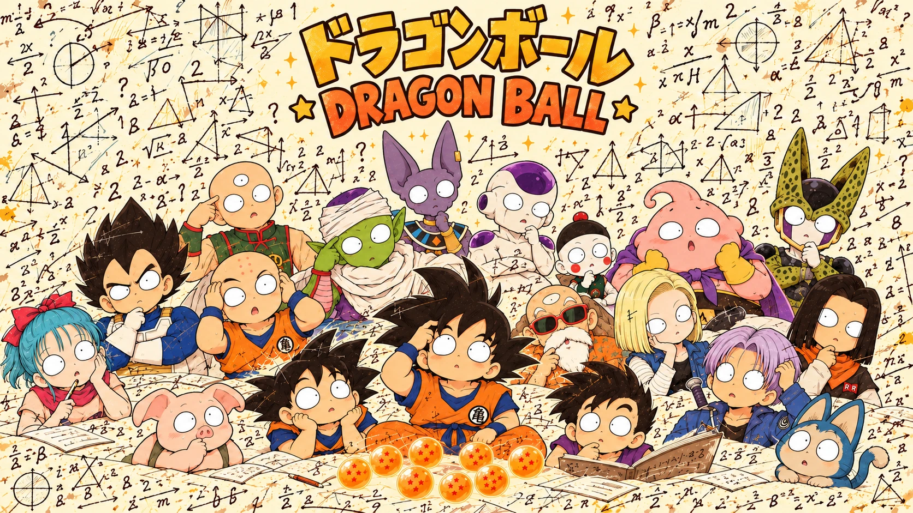

把角色统一到“思考”这一动作主题，用桌面前后关系组织多排人物。米黄纸底、橙色服装与手写公式相互呼应，让高密度背景仍有共同秩序。

A shared thinking gesture connects multiple rows of characters. Desks establish depth, while warm paper, orange garments and handwritten formulas give the dense scene a consistent visual order.

**设计亮点 / Craft:** 统一动作主题 · 场景分层 · 背景叙事 / Shared gesture · Layered staging · Narrative background

原文件 / Source: **1672 × 941** · 网页展示 / Display: **1672 × 941**

## 03 · 少年与筋斗云 · 收藏海报

**Young hero & Nimbus · collector poster** · Dragon Ball

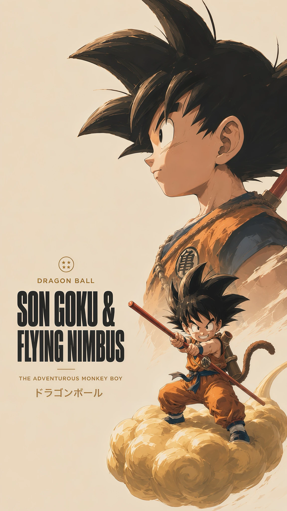

以大幅侧脸和下方小比例动作人物形成双尺度叙事。暖纸色与橙黑对比、左侧文字区和完整云团，让人物插画与海报排版相互支撑。

An oversized profile and a smaller action figure create a two-scale narrative. Warm paper, orange-black contrast and a reserved typography column connect illustration with poster layout.

**设计亮点 / Craft:** 双尺度构图 · 纸本色调 · 文字层级 / Two-scale composition · Paper palette · Type hierarchy

原文件 / Source: **1920 × 3412** · 网页展示 / Display: **1152 × 2048**

## 04 · 并肩出击 · 三人合力

**Side by side · shared energy** · Dragon Ball

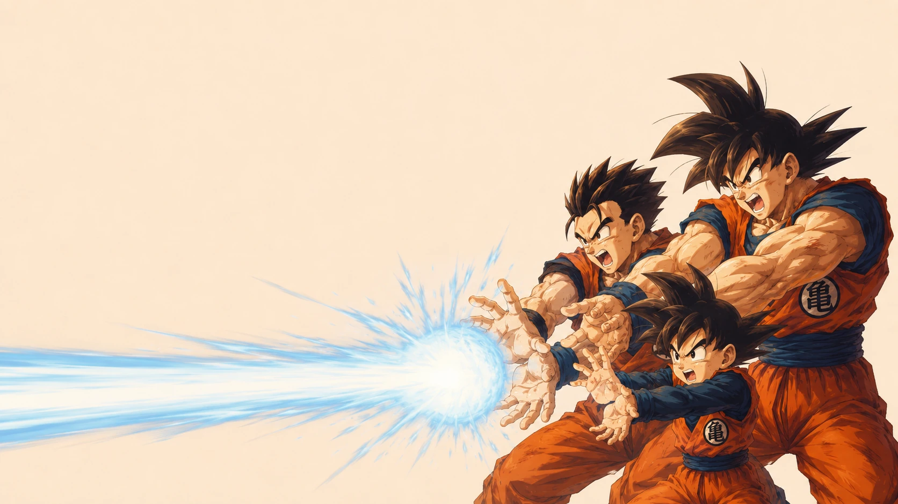

把三人的视线、手势和能量方向收束到同一个焦点。人物集中在右侧，向左延展的蓝色光束与大块留白，让动作和桌面空间同时成立。

Three gazes, hand gestures and energy trails converge on one focal point. A right-weighted cast and a leftward blue beam balance action with usable desktop space.

**设计亮点 / Craft:** 动作方向一致 · 集中视觉焦点 · 横屏留白 / Aligned gestures · Unified focus · Desktop negative space

原文件 / Source: **1672 × 941** · 网页展示 / Display: **1672 × 941**

## 05 · 金色传承 · 家族肖像

**Golden legacy · family portrait** · Dragon Ball

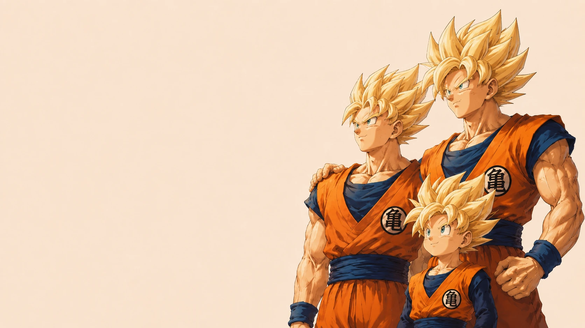

用三角站位和肩部接触构成人物之间的情感连接。金发、橙衣和蓝色阴影保持统一色组，左侧暖色留白减轻多人画面的重量。

Triangular staging and a hand on the shoulder connect the figures emotionally. Golden hair, orange clothing and blue shadows form a unified palette against generous warm space.

**设计亮点 / Craft:** 三角站位 · 情感动作 · 色组统一 / Triangular staging · Emotional gesture · Unified color groups

原文件 / Source: **1672 × 941** · 网页展示 / Display: **1672 × 941**

## 06 · 龙珠微光 · 夜色围坐

**Dragon Ball glow · night gathering** · Dragon Ball


以发光球体作为主要光源，让脸部、手部与地面产生连贯的暖色受光。巨龙藏在暗处，靠轮廓和双眼维持第二层叙事。

A glowing sphere lights faces, hands and the ground with a coherent warm source. The dragon remains in shadow, adding a second narrative layer through its silhouette and eyes.

**设计亮点 / Craft:** 单一叙事光源 · 暗部层次 · 前后景呼应 / Story-driven key light · Layered shadows · Foreground-background connection

原文件 / Source: **1672 × 941** · 网页展示 / Display: **1672 × 941**

## 07 · 靛蓝全员 · 横版收藏

**Indigo ensemble · landscape edition** · Dragon Ball

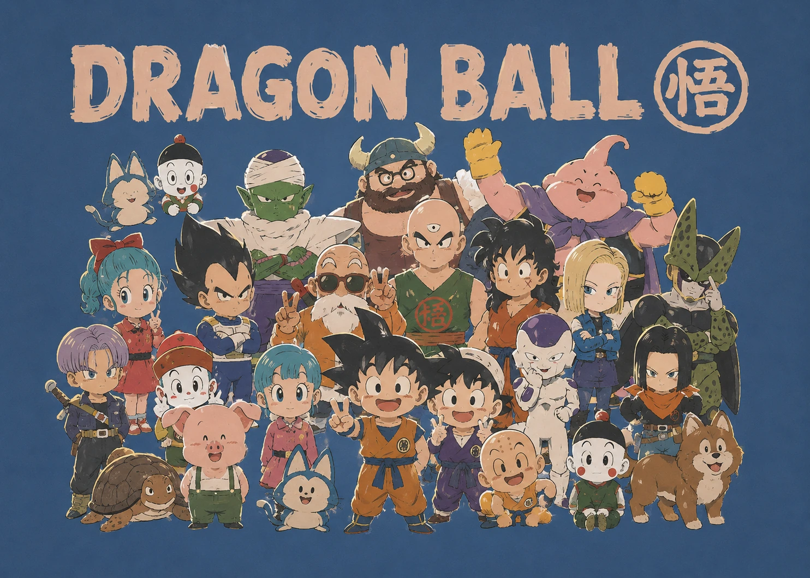

把大群像组织成上宽下稳的整体，保留人物表情和层间间隙。统一的蓝纸背景、低饱和服装和粗笔标题，形成复古印刷感。

A broad, balanced ensemble keeps expressions and row spacing readable. Blue paper, muted clothing and a rough display title establish a vintage print character.

**设计亮点 / Craft:** 群像层级 · 低饱和统一 · 复古印刷感 / Ensemble hierarchy · Muted palette · Vintage print texture

原文件 / Source: **1484 × 1060** · 网页展示 / Display: **1484 × 1060**

## 08 · 靛蓝全员 · 竖版重构

**Indigo ensemble · portrait recomposition** · Dragon Ball

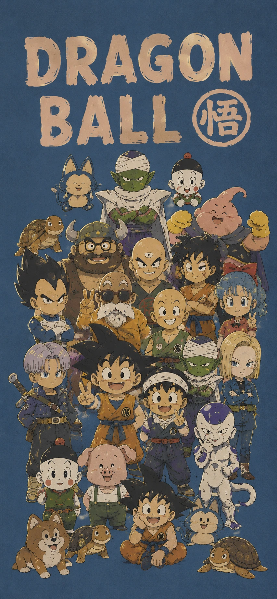

将横向群像改为纵向堆叠，让标题与人物形成上下节奏。保留蓝纸材质和角色色组，体现同一主题在手机长屏中的重新组织。

The ensemble becomes a vertical stack with a clear title-to-character rhythm. The same paper texture and character palette carry the theme into a phone-oriented composition.

**设计亮点 / Craft:** 横竖屏重构 · 纵向节奏 · 系列一致性 / Format recomposition · Vertical rhythm · Series consistency

原文件 / Source: **853 × 1844** · 网页展示 / Display: **853 × 1844**

## 09 · 龙珠 × 足球 · 主题群像

**Dragon Ball × football · themed ensemble** · Dragon Ball

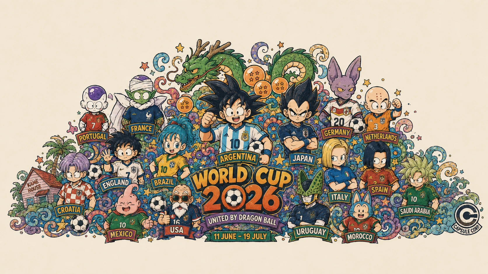

以中央赛事主题字块作为锚点，让角色、足球、云纹与龙形装饰围绕它展开。两侧元素逐步降低高度，保持宽幅画面的中心与边缘关系。

A central football-themed title anchors characters, balls, cloud patterns and dragon motifs. A tapering silhouette gives the wide composition a clear center and controlled edges.

**设计亮点 / Craft:** 跨主题整合 · 中心锚点 · 装饰密度控制 / Theme integration · Central anchor · Controlled ornament density

原文件 / Source: **1672 × 941** · 网页展示 / Display: **1672 × 941**

## 10 · 全职猎人 × 足球 · 联动构想

**Hunter × Hunter × football · crossover concept** · Hunter × Hunter

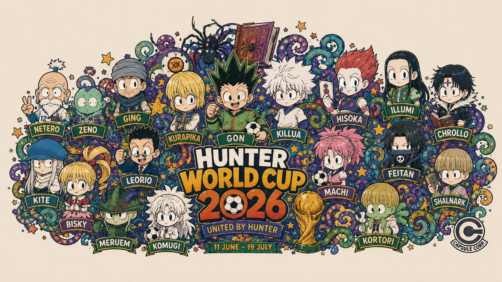

这张是《全职猎人》主题。用角色服装、道具与姓名牌构成各自的识别单元，再以同一纸本色调和装饰纹样连接成完整群像。

This is the Hunter × Hunter piece. Clothing, props and nameplates create distinct character units, connected by one paper palette and a coherent family of decorative motifs.

**设计亮点 / Craft:** 角色识别单元 · 密集信息编排 · 跨作品延展 / Character identity units · Dense information layout · Cross-franchise adaptation

原文件 / Source: **1672 × 941** · 网页展示 / Display: **1672 × 941**

## 11 · 暖红重逢 · 横版合影

**Warm red reunion · landscape portrait** · Dragon Ball

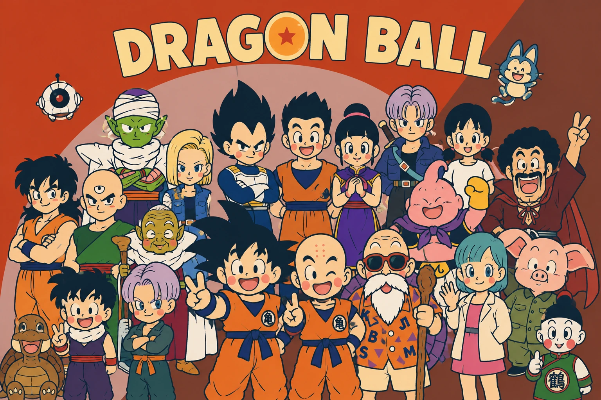

以橙红背景和浅色弧面拉开人物层次，密集群像仍保留明确的面部区隔。少量深蓝轮廓与暖肤色呼应，强化轻松明快的整体情绪。

Orange-red ground and a pale arc separate the cast into readable layers. Dark blue contours and warm skin tones keep the dense reunion cheerful and visually coherent.

**设计亮点 / Craft:** 暖色情绪 · 面部分隔 · 弧面构图 / Warm emotional palette · Readable faces · Arc-based composition

原文件 / Source: **1536 × 1024** · 网页展示 / Display: **1536 × 1024**

## 12 · 暖红重逢 · 手机长屏

**Warm red reunion · phone edition** · Dragon Ball

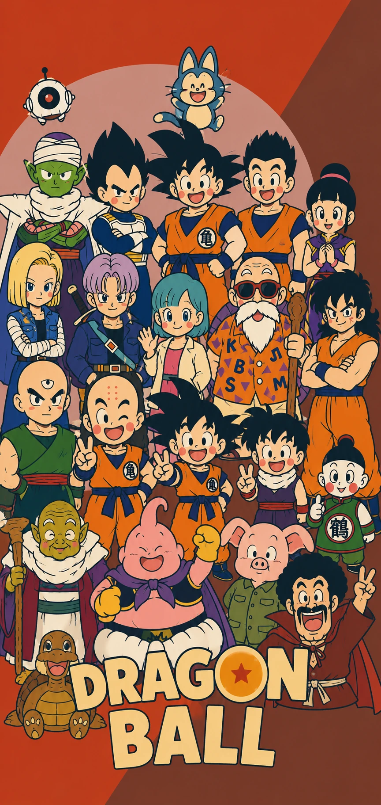

将角色重新排成多层纵向队列，以小型陪衬角色和下方标题形成收尾。保留横版的线条与色彩语言，而不是直接裁掉横图两侧。

A newly arranged vertical cast uses smaller companions and a bottom title to close the composition. It preserves the landscape edition’s line and color language without simply cropping its sides.

**设计亮点 / Craft:** 角色重新排布 · 长屏适配 · 横竖系列感 / Rearranged cast · Phone adaptation · Cross-format identity

原文件 / Source: **864 × 1821** · 网页展示 / Display: **864 × 1821**

## 13 · 四星球 · 巨物与小小少年

**Four-star ball · a world of scale** · Dragon Ball

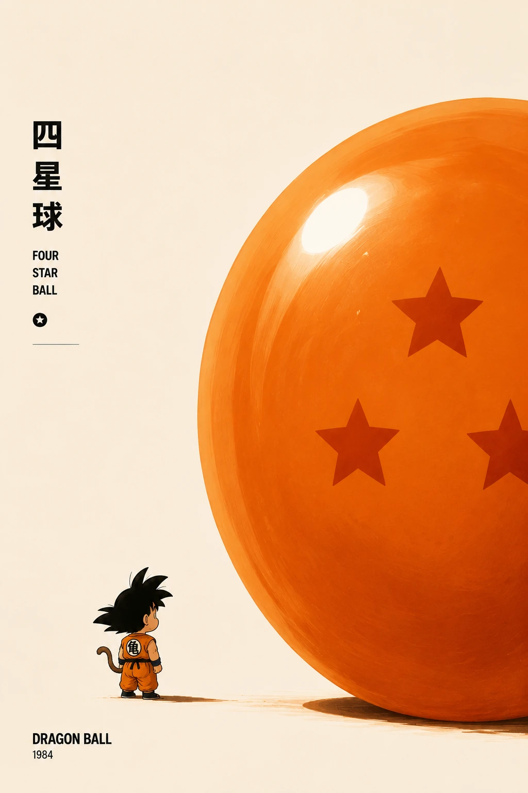

用极大的橙色球体与极小的人物形成直接的尺度反差。奶油底色、左侧竖排标题和受控的反光，把简单元素组织成有张力的收藏海报。

A giant orange sphere contrasts with a tiny figure. Cream paper, a vertical title and restrained highlights turn a few simple elements into a striking collector poster.

**设计亮点 / Craft:** 尺度反差 · 极简留白 · 橙黑强调 / Scale contrast · Minimal negative space · Orange-black emphasis

原文件 / Source: **1024 × 1536** · 网页展示 / Display: **1024 × 1536**

## 14 · 四星球 04 · 编辑网格

**Four-star ball 04 · editorial grid** · Dragon Ball


用超大数字、几何网格和分栏文字建立版式骨架。球体切入网格，小人物压住底部基线，让平面排版与叙事主体保持联系。

An oversized numeral, thin grid and text columns create the layout structure. The sphere cuts through the grid while the small figure anchors the baseline, connecting graphic design with narrative.

**设计亮点 / Craft:** 编辑网格 · 字体尺度 · 插画与排版整合 / Editorial grid · Typographic scale · Illustration-type integration

原文件 / Source: **1024 × 1536** · 网页展示 / Display: **1024 × 1536**

## 15 · ORBIT · 七颗球的轨迹

**ORBIT · paths of seven spheres** · Dragon Ball

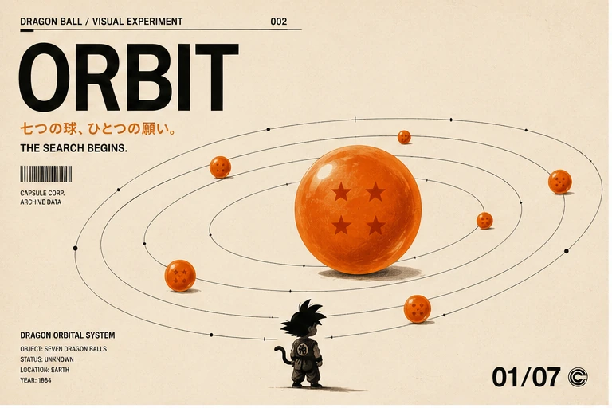

用轨道线把散落的球体组织成一套清楚的视觉关系。大标题、细注释与底部人物形成尺度层级，纸张肌理贯穿整个系统。

Orbital lines organize separate spheres into a legible system. A large title, small annotations and a bottom figure create a deliberate scale hierarchy across one paper surface.

**设计亮点 / Craft:** 几何叙事 · 注释层级 · 纸本系统感 / Geometric storytelling · Annotation hierarchy · Cohesive paper system

原文件 / Source: **768 × 512** · 网页展示 / Display: **768 × 512**

## 16 · 满月之夜 · 剪影叙事

**Full moon · silhouette narrative** · Dragon Ball

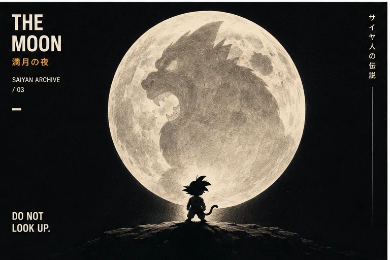

用明亮月面承托小人物剪影，再把巨猿轮廓嵌入月亮形成隐藏叙事。黑金色调、低位地平线和稀疏文字，让气氛成为画面的主角。

A bright moon supports the small figure’s silhouette, with an ape-shaped shadow adding a hidden story. Black-gold tones, a low horizon and sparse type give atmosphere the leading role.

**设计亮点 / Craft:** 图底关系 · 隐藏叙事 · 黑金气氛 / Figure-ground contrast · Hidden narrative · Black-gold atmosphere

原文件 / Source: **768 × 512** · 网页展示 / Display: **768 × 512**

## 17 · 冒险片段 · 横版分镜拼贴

**Adventure fragments · landscape collage** · Dragon Ball

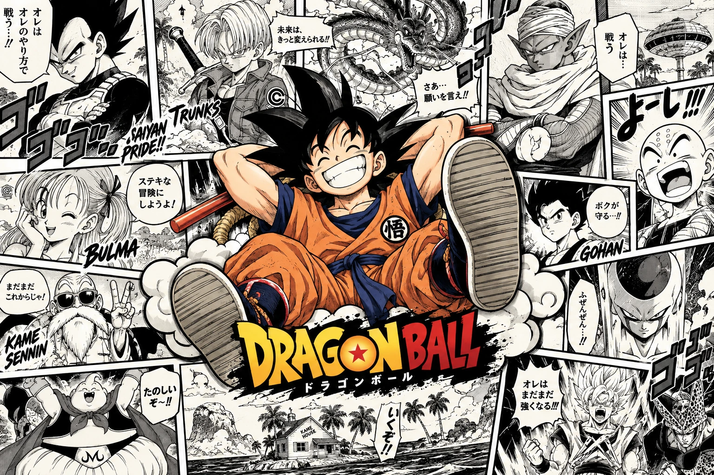

以彩色主角压住黑白分镜背景，利用鞋底透视制造前后深度。分镜边框与大标题构成视觉节拍，使密集内容仍有明确主角。

A colored protagonist leads a monochrome panel background, with foreshortened shoes adding depth. Panel borders and a bold title create rhythm without losing the main subject.

**设计亮点 / Craft:** 彩色与黑白分层 · 透视焦点 · 分镜节奏 / Color-monochrome hierarchy · Perspective focus · Panel rhythm

原文件 / Source: **1536 × 1024** · 网页展示 / Display: **1536 × 1024**

## 18 · 冒险片段 · 竖版阅读路径

**Adventure fragments · vertical reading path** · Dragon Ball

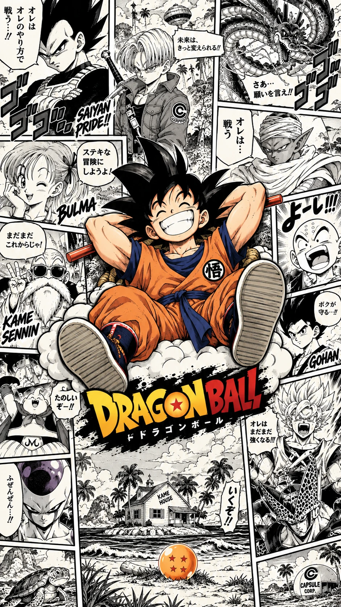

把主角、标题和龙珠沿纵向串联，让视线从上方人物走向下方故事细节。黑白分镜保留情绪线索，彩色区域负责建立主次。

The protagonist, title and sphere form a vertical path through the composition. Monochrome panels carry story cues while the colored regions establish hierarchy.

**设计亮点 / Craft:** 纵向阅读路径 · 主次色彩 · 长屏叙事 / Vertical reading path · Color hierarchy · Phone storytelling

原文件 / Source: **941 × 1672** · 网页展示 / Display: **941 × 1672**

## 19 · 永不结束的冒险 · 群像长卷

**Never-ending adventure · ensemble panorama** · Dragon Ball


以墙面作为大群像的共同落点，把主角与伙伴组织成中心展开的扇形。外围黑白故事片段和前景道具提供回忆层次，彩色角色保持叙事核心。

A shared wall grounds a fan-shaped ensemble expanding from the center. Monochrome story fragments and foreground props add layers of memory while colored characters remain the narrative core.

**设计亮点 / Craft:** 共同空间落点 · 群像中心展开 · 故事层次 / Shared spatial anchor · Center-out ensemble · Layered storytelling

原文件 / Source: **1672 × 941** · 网页展示 / Display: **1672 × 941**

## 20 · 海岛重逢 · 纵向全员叙事

**Island reunion · vertical ensemble story** · Dragon Ball

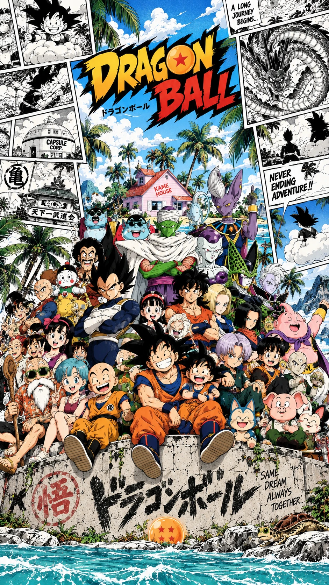

从天空、标题、建筑、人物到海面建立完整的纵向场景。中央彩色世界与两侧黑白分镜互相映照，用色彩范围控制丰富信息的阅读顺序。

Sky, title, architecture, cast and sea form a complete vertical scene. A colored central world and monochrome side panels work together, using selective color to guide a dense composition.

**设计亮点 / Craft:** 完整场景纵深 · 彩色范围控制 · 多层人物组织 / Complete scene depth · Selective color · Layered cast arrangement

原文件 / Source: **941 × 1672** · 网页展示 / Display: **941 × 1672**


</details>

## 网站是什么？

网页把设计方法、图像生成和 Agent 使用入口放在一起：

- **工作台：** 填写主题，选择方向、用途与配色；使用自己填写的图像 API Key 生成。
- **作品实例：** 分类浏览本次20件Skill作品，放大查看完整构图与设计亮点。
- **动漫方法：** ROCC 风格置首，另有七龙珠、火影、哆啦A梦研究方向。
- **使用 Skill：** 选择 Codex 或 Claude Code，网页整理指令并打开相应工具，用户确认发送；首次导入说明随任务提供。
- **评估记录：** 展示各方向的验收重点和真实评估进度，旧版样本单独保留，不把历史结果当成新方法的成功率。
- **中文 / English：** 界面与制作任务可切换语言。

### 入口导航

| 入口 | 用途 |
| --- | --- |
| [动漫壁纸工作台](https://rocc-wallpaper-studio-lab.rocc94.chatgpt.site/?lang=zh#studio) | 填写主题、选择风格，使用自己的图像 API |
| [Skill 作品实例](https://rocc-wallpaper-studio-lab.rocc94.chatgpt.site/?lang=zh#showcase) | 浏览20件作者确认的Skill作品及设计说明 |
| [动漫设计方法](https://rocc-wallpaper-studio-lab.rocc94.chatgpt.site/?lang=zh#methods) | 查看 ROCC、七龙珠、火影、哆啦A梦四个方向 |
| [Codex / Claude Code 使用入口](https://rocc-wallpaper-studio-lab.rocc94.chatgpt.site/?lang=zh#install) | 整理任务并交给你的 Agent；也可下载离线包 |
| [评估记录](https://rocc-wallpaper-studio-lab.rocc94.chatgpt.site/?lang=zh#evaluation) | 查看当前评估状态与验收标准 |
| [English website](https://rocc-wallpaper-studio-lab.rocc94.chatgpt.site/?lang=en#studio) | Open the studio in English |

网页适配 OpenAI GPT Image、Google Gemini / Nano Banana、豆包 Seedream、Qwen Image、Wan、Grok Imagine、FLUX、Stability 和 Ideogram。自动模式只在已配置服务中选择，支持手动覆盖；不自动重试或跨平台补单。各服务真实账号的权限、地区、额度与生成质量需自行验证。

Key 只在当前页临时保留；一次生成仅将所选 Key 经本站服务端转发至相应服务，不写入保存的配方或数据库。模型费用由使用者自己的账号承担。网站不会获得你的 Codex / Claude 订阅额度。

## 最简单：把这段话发给你的 AI

```text
请读取 https://github.com/rocc94/rocc-wallpaper-studio 。
把其中适用于当前工具的 rocc-wallpaper-studio Skill 安装到我选择的项目；保留已有文件。
这次直接读取 Skill，使用 ROCC 风格，制作一张原创屋顶信使的动漫壁纸，比例2:3，纸本暖色。
先检查可用图像工具；有能力再出图，没有就明确交付未执行的制作单。不在聊天中索要 Key。
```

也可以在网站的“使用 Skill”页填写主题，再点击打开 Codex / Claude Code。按钮会预填任务，**不会替你自动发送、安装或执行**。无需在网站填写 Key：Codex 按钮打开本机桌面应用，Claude Code 按钮打开本机终端并预填任务，也可选择 Claude 桌面端。需要安装并登录自己的工具；浏览器可能要求允许打开应用。首次读取或安装遵守工具权限，未唤起时复制指令即可。

### 克隆项目后使用

```bash
git clone https://github.com/rocc94/rocc-wallpaper-studio.git
cd rocc-wallpaper-studio
```

在 Codex 或 Claude Code 中打开该文件夹：

- Codex：`$rocc-wallpaper-studio 帮我做一张动漫壁纸`
- Claude Code：`/rocc-wallpaper-studio 帮我做一张动漫壁纸`

首次未自动发现时，重新打开项目/重启工具，或让 Agent 直接读取对应 `SKILL.md` 执行本次任务。

| 工具 | 项目内 Skill 路径 |
| --- | --- |
| Codex | [`.agents/skills/rocc-wallpaper-studio`](.agents/skills/rocc-wallpaper-studio) |
| Claude Code | [`.claude/skills/rocc-wallpaper-studio`](.claude/skills/rocc-wallpaper-studio) |

两个目录由同一套源文件生成。安装 Skill 不会附送图像模型：Codex 可使用可用的会话内置 image 工具；Claude Code 需要已经配置的图像 MCP/API。没有出图能力时，交付制作单并如实说明。

## 原创示例


用于说明画面方向的原创主题示例，实际尺寸 1024 × 1536。它不是质量测评或效果保证。生成来源记录见 [provenance.json](assets/provenance.json)。

## English quick start

ROCC Wallpaper Studio combines a web workspace with an open-source Skill for **Codex and Claude Code**. Art directions: **ROCC signature · Dragon Ball · Naruto · Doraemon**. The web studio supports Chinese and English, your own image API keys, agent-task handoff and transparent evaluation status.

**Website:** [Open in English](https://rocc-wallpaper-studio-lab.rocc94.chatgpt.site/?lang=en#studio) · [Use your agent](https://rocc-wallpaper-studio-lab.rocc94.chatgpt.site/?lang=en#install). The website is publicly accessible without a ROCC account. Open local Codex or Claude Code with a prefilled task and no API key entered on the site. Claude Desktop and copy/paste are available as alternatives. Install and sign in to your own tool, review the task and send it yourself. Image tools and usage depend on your account and configuration.

Paste into your agent:

```text
Read https://github.com/rocc94/rocc-wallpaper-studio and install its ROCC Wallpaper Studio Skill for this tool into my selected project, preserving existing files.
Read the Skill directly for this task. Create one original rooftop-courier anime wallpaper using the ROCC recipe, 2:3, warm paper palette.
Check for a real image tool first. Generate only if capable and authorized; otherwise provide an explicitly unexecuted brief. Never ask for API keys in chat.
```

Open a clone in Codex or Claude Code to use the included standard project-level Skill folders. Website launch buttons prefill a task; **you review and send it in your own tool**. Claude Code cloud also needs a repository you can access. Installing this Skill does not supply an image model, API credits or a subscription.

This repository distributes the Skill, helper scripts, documentation, the earlier original example and 20 author-confirmed Skill showcase works. The complete web application source and the full wallpaper library are not included. [View all 20 works and bilingual design notes](SHOWCASE.md).

## 方法来源与使用边界 / Provenance & rights

ROCC 的一般设计方向来自成品观察推断（460份文件元数据、71张视觉抽样），历史提示词尚未提供。三个动漫专题是新增研究方向，尚未完成质量对照；没有训练模型，不承诺每次生成合格。本次额外收录作者明确选择的20件Skill作品展示，不代表已完成独立评测。

七龙珠 / Dragon Ball、火影 / Naruto、哆啦A梦 / Doraemon 是研究方向名称，不代表官方关联、角色授权或商业使用许可。请使用新构图，并核对实际用途所需权利。代码与说明采用 [MIT License](LICENSE)，第三方角色、作品和参考素材不包含在本项目许可中。[本次20件作品的图片说明](assets/showcase/LICENSE.md)单独列出。示例采用原创主题，由会话图像工具生成，底层模型未公开。

## 官方能力参考 / Official references

核对日期 / Checked: 2026-10-26.

[Codex deep links](https://learn.chatgpt.com/docs/reference/commands#deep-links) · [Codex Skills](https://learn.chatgpt.com/docs/build-skills) · [Claude Code Skills](https://code.claude.com/docs/en/skills) · [Claude Code local deep links](https://code.claude.com/docs/en/deep-links) · [Claude Desktop deep links](https://support.claude.com/en/articles/14729294-open-claude-desktop-with-a-link).
